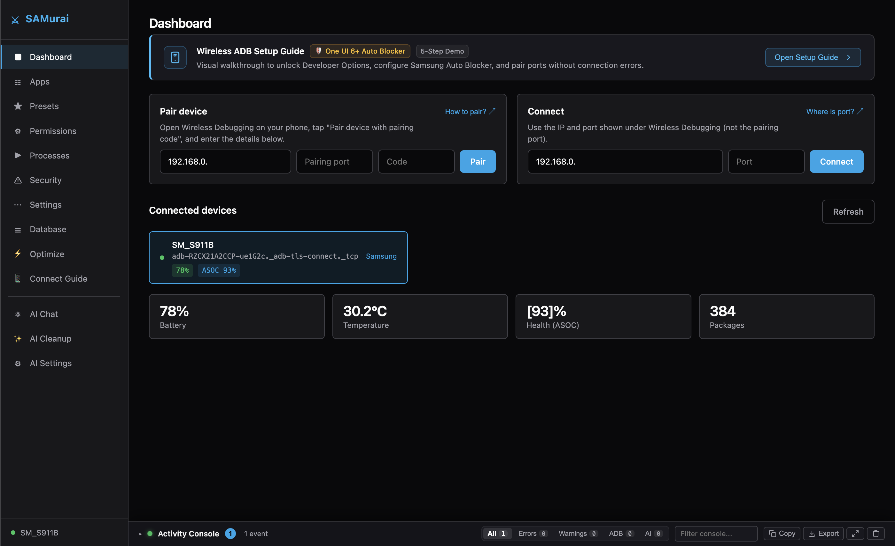
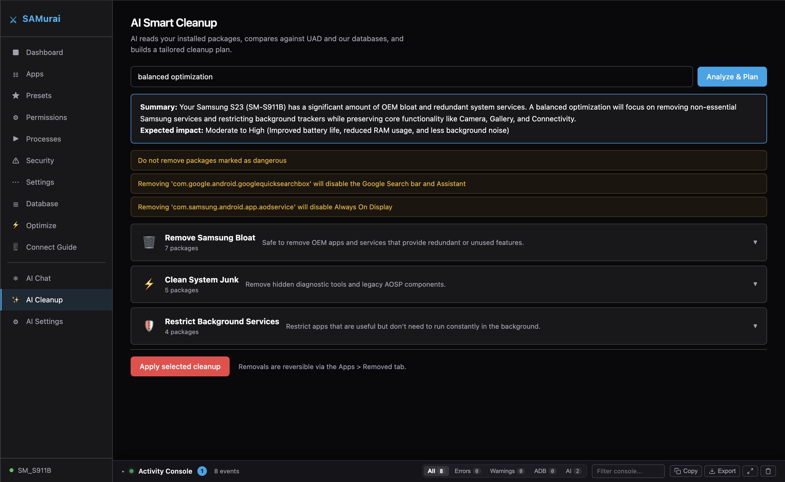
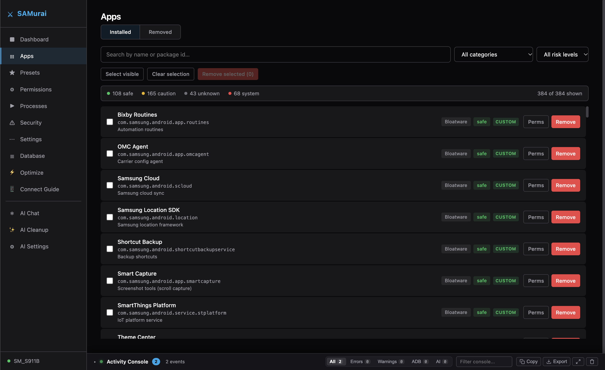
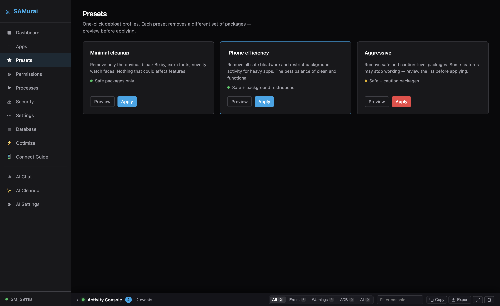
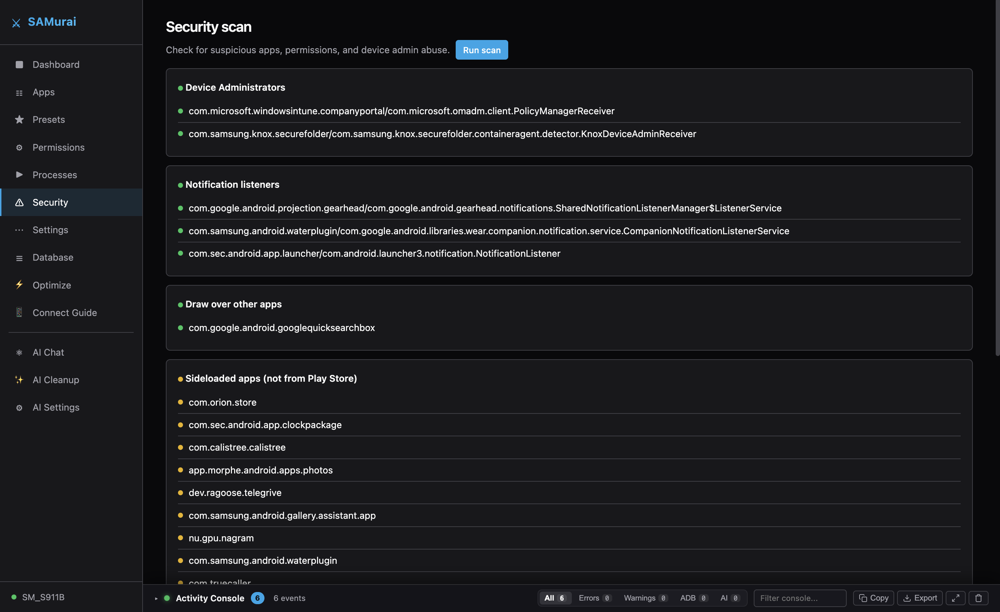
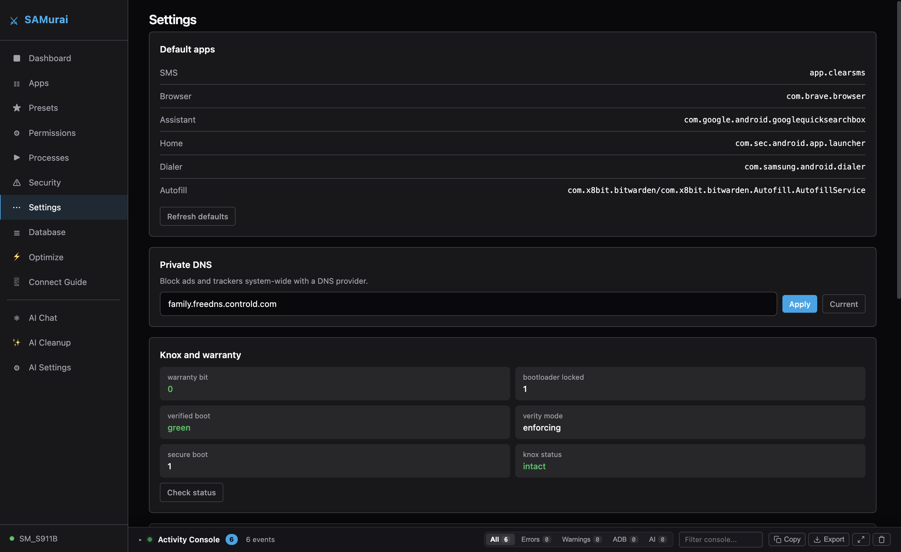
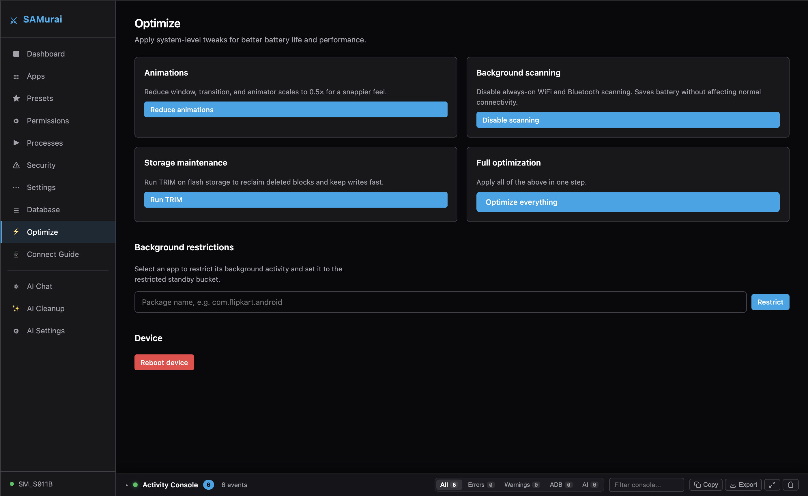

# 🥷 SAMurai — AI-Powered Android Debloater & Optimizer

SAMurai is a zero-dependency, web-based tool for debloating, securing, and optimizing Android smartphones and watches via ADB. It combines **autonomous Generative AI package analysis** with a curated 5,400+ package database to safely remove bloatware, reduce background battery drain, and inspect true hardware battery health.

Runs entirely on the Python 3 standard library — no pip packages, npm dependencies, or build tools required.

Supports **Samsung Galaxy**, **Google Pixel**, **Xiaomi / HyperOS**, **OnePlus**, **Realme**, **OPPO**, and **Vivo** devices.



> [!WARNING]
> ### ⚠️ Disclaimer — Use at Your Own Risk
> Modifying system packages, restricting background processes, or altering system configurations can affect device stability. While SAMurai uses non-destructive user-space uninstalls (`pm uninstall -k --user 0`) that preserve data and are fully reversible, **you are solely responsible for actions performed on your device**. Always review package selections and create backups before applying aggressive presets.

---

## 🚀 Quick Start

Choose between our standalone prebuilt desktop applications or instant zero-dependency source runners:

### Option 1: Standalone Desktop Applications (Recommended)

Download the latest prebuilt packages directly from our [GitHub Releases](https://github.com/antonysamuel/SAMurai-Android-Debloater/releases/latest):

| Platform | Format | Download Link | Notes |
| :--- | :--- | :--- | :--- |
| **macOS** | `.dmg` installer | [**Download SAMurai-macOS.dmg**](https://github.com/antonysamuel/SAMurai-Android-Debloater/releases/latest) | Apple Silicon & Intel. Drag to `/Applications`. |
| **Linux** | `.AppImage` | [**Download SAMurai-x86_64.AppImage**](https://github.com/antonysamuel/SAMurai-Android-Debloater/releases/latest) | Standalone package. `chmod +x` and run. |
| **Windows** | Source / One-Click | [Run via `SAMurai.bat`](#option-2-run-from-source-zero-pip-dependencies) | Pure Python stdlib; no install needed. |

> [!NOTE]
> ### 🍎 macOS Gatekeeper Warning & Bypass Instructions
> Because SAMurai is an open-source, community-driven project not signed with a paid Apple Developer certificate ($99/year), macOS Gatekeeper may present a dialog stating:
> *"SAMurai.app cannot be opened because the developer cannot be verified"* or *"Apple cannot check it for malicious software."*
>
> You can bypass this in seconds using either method:
>
> 1. **Finder (GUI - Recommended)**:
>    * Open `/Applications` in Finder.
>    * **Right-click** (or `Control`-click) on **SAMurai.app** and choose **Open**.
>    * Click **Open** in the confirmation dialog. macOS remembers this choice and won't prompt again.
> 2. **Terminal (One-Line Command)**:
>    * If macOS reports the application as damaged or blocked, open Terminal and run:
>      ```bash
>      xattr -cr /Applications/SAMurai.app
>      ```
>      *(This clears the `com.apple.quarantine` extended attribute attached by your browser).*

---

### Option 2: Run from Source (Zero pip dependencies)

Launch SAMurai in seconds using our smart launchers that auto-discover ADB and resolve Python / `uv`:

#### 🍎 macOS (One-Click)
```bash
git clone https://github.com/antonysamuel/SAMurai-Android-Debloater.git
cd SAMurai-Android-Debloater
```
Double-click **`SAMurai.command`** in Finder (or run `./SAMurai.sh` in Terminal).

#### 🐧 Linux (One-Click or Terminal)
```bash
git clone https://github.com/antonysamuel/SAMurai-Android-Debloater.git
cd SAMurai-Android-Debloater
chmod +x SAMurai.sh && ./SAMurai.sh
```

#### 🪟 Windows (Double-Click)
```cmd
git clone https://github.com/antonysamuel/SAMurai-Android-Debloater.git
cd SAMurai-Android-Debloater
```
Double-click **`SAMurai.bat`** (or run `python debloater.py`).

> [!TIP]
> **Zero-Friction Runtime Resolution**: No Python 3 installed? The launcher automatically checks for Astral's `uv` (`uv run python`), offers one-click zero-root setup, and auto-discovers Android SDK platform-tools in your user directory if missing from `$PATH`.

The dashboard opens automatically in your browser (or standalone desktop window) at `http://127.0.0.1:8080`.

---

## 📱 2-Minute Wireless Setup

1. **Samsung One UI 6.0+**: Open **Settings → Security and privacy → Auto Blocker** and toggle it **OFF** *(Auto Blocker blocks wireless ADB handshakes and cable commands)*.
2. **Enable Wireless Debugging**: Open **Settings → Developer Options → Wireless Debugging** and toggle it **ON**.
3. **Pair the Device**:
   * Tap *"Pair device with pairing code"*.
   * In SAMurai's Dashboard, enter the IP, the 5-digit **Pairing Port** from the popup, and the 6-digit **Code** → Click **Pair**.
4. **Connect**:
   * Note the main IP & Port shown on the parent Wireless Debugging screen (not the pairing port).
   * Enter the port and click **Connect**.

*(You can also click **"Open Setup Guide"** in SAMurai's dashboard for an interactive 5-step animated walkthrough).*

---

## 🤖 The AI-Powered Debloating Advantage

Traditional debloating tools rely strictly on static, one-size-fits-all package lists that quickly grow stale as OEMs push OS updates. SAMurai brings **LLM intelligence directly into your debloating workflow**:



* **Autonomous Manifest Analysis**: SAMurai reads your phone's live package manifest and feeds it to your chosen AI model. The AI cross-references your installed packages against the 5,400+ Universal Android Debloater database, classifies unknown OEM services, and crafts a customized, goal-driven debloat plan.
* **Goal-Oriented Optimization**: Specify what you want to achieve — such as *"Aggressive Battery Saver"*, *"Minimalist Pixel-like Experience"*, or *"Gaming & RAM Headroom"* — and the AI evaluates which services to remove and which to restrict to background standby buckets.
* **In-App AI Chat Consultant**: Ask natural language questions in real-time right inside the app (e.g. *"Can I safely remove `com.samsung.android.app.routines`?"* or *"What dependencies break if I uninstall Quick Share?"*).
* **Multi-Provider & Offline Local AI**:
  * **Cloud Providers**: Native support for **NVIDIA Nemotron**, **Google Gemini**, **OpenAI**, **Groq**, and **OpenRouter**.
  * **100% Private & Offline**: Point SAMurai to local **Ollama** (`http://localhost:11434/v1`) running Llama 3, Mistral, or Gemma on your own machine. Zero API keys, zero cloud telemetry.

---

## 🔋 Hardware Battery Health (ASOC) — Samsung Devices

One of SAMurai's standout features is the ability to read real, calibrated hardware battery capacity directly from device kernel telemetry:


* **Real Hardware ASOC**: Reads the true `mSavedBatteryAsoc` (Actual State of Charge percentage) and `BSOH` (Battery State of Health) metrics, cycle counts, voltage, and real-time thermals.
* **Beyond Android's Standard UI**: Standard Android builds typically hide true hardware battery degradation percentages from users. SAMurai extracts deep hardware battery metrics via `dumpsys battery`.
* **Important Compatibility Note**:
  > [!NOTE]
  > **Tested & Verified on Samsung Galaxy devices only.** Samsung One UI devices expose internal battery calibration registers through their power management HAL. On non-Samsung devices (Pixel, Xiaomi, OnePlus, etc.), standard battery level and temperature are displayed, but the ASOC health percentage may report as unavailable or uncalibrated depending on OEM firmware restrictions.

---

## ✨ Features Overview

### 1. Smart Package Management & Layered Catalog
* **5,400+ Classified Packages**: Layered classification leveraging the [Universal Android Debloater (UAD)](https://github.com/Universal-Debloater-Alliance/universal-android-debloater-next-generation) database, OEM brand dictionaries, and curated safety tiers.
* **Risk Categorization**: Clear badges for **Safe** (100% bloatware), **Caution** (feature-dependent), **Dangerous** (protected/system-critical), and **Unknown**.
* **Reversible Uninstalls**: Uses `pm uninstall -k --user 0` to disable packages for User 0 while preserving user data and system partition integrity.
* **One-Click Reinstall**: Easily restore uninstalled packages anytime from the **Removed** tab.



---

### 2. One-Click Debloat Presets
Quickly optimize devices with tested debloat profiles:
* **Minimal Cleanup**: Removes obvious bloatware (Bixby, promo apps, novelty watch faces, carrier diagnostics).
* **iPhone Efficiency**: Removes safe bloatware and restricts background execution for aggressive power-hungry apps for a clean, snappy iOS-like standby experience.
* **Aggressive**: Strips non-essential OEM suites for maximum battery life and RAM headroom.



---

### 3. Deep Security Audit & Knox Verification
* **Security Scanner**: Inspects active **Device Administrators**, **Notification Listeners**, **Draw-over-other-apps (Overlay)** privileges, and audits **Sideloaded apps** installed from outside official stores.
* **Samsung Knox & Warranty Bit**: Verifies hardware `warranty_bit` (`0x0`), verified boot state (`green`), and bootloader lock integrity.




---

### 4. Hardware Optimization & System Tweaks
* **Performance Speedup**: Tune animation scaling (`0.5x` / off) for an instant snappier feel.
* **Background Scanning**: Disable always-on Wi-Fi and Bluetooth background scanning to save battery.
* **Storage TRIM**: Run manual hardware `fstrim` across flash storage partitions to reclaim deleted flash blocks and maintain high write speeds.
* **Granular Permission Manager**: Inspect and revoke sensitive runtime permissions (Location, Contacts, Call Logs, Storage) per application.



---

## 📋 Requirements

* **Python 3.6+** or Astral's **`uv`** (Standard library only — zero pip dependencies required)
* **ADB** (Android Debug Bridge)
  * **macOS**: `brew install android-platform-tools`
  * **Debian / Ubuntu**: `sudo apt install adb`
  * **Fedora**: `sudo dnf install android-tools`
  * **Arch Linux**: `sudo pacman -S android-tools`
  * **Windows**: Download standalone binaries from [Android SDK Platform Tools](https://developer.android.com/tools/releases/platform-tools)
* **Wireless Debugging** or **USB Debugging** enabled on the Android device.

---

## 📁 Project Architecture

```
SAMurai/
├── debloater.py              # Application entrypoint & HTTP server bootstrap
├── SAMurai.command           # macOS double-click launcher
├── SAMurai.sh                # Linux & macOS smart shell launcher
├── SAMurai.bat               # Windows double-click launcher
├── assets/                   # Screenshots and UI media
│   ├── dashboard.png
│   ├── apps-manager.png
│   ├── ai-cleanup.png
│   ├── presets.png
│   ├── permissions.png
│   ├── processes.png
│   ├── security-scan.png
│   ├── settings-knox.png
│   └── optimizer.png
├── src/                      # Pure Python stdlib backend (Zero external dependencies)
│   ├── adb.py                # ADB command execution & output parsing
│   ├── ai.py                 # Multi-provider AI interface (OpenAI, Gemini, Ollama)
│   ├── battery.py            # Battery metrics, ASOC calibration, charging controls
│   ├── database.py           # Layered JSON databases & GitHub UAD auto-sync
│   ├── devices.py            # Device listing, brand discovery, and device classification
│   ├── packages.py           # Package listing, removal, restoration, and presets
│   ├── security.py           # Security scanner, permission manager, process inspector
│   ├── server.py             # Built-in HTTP server & REST API handlers
│   └── settings.py           # Default apps, Private DNS, Knox warranty status
├── data/
│   ├── packages.json         # Custom curated package classifications
│   ├── brands.json           # OEM-specific bloatware database
│   ├── presets.json          # Minimal, iPhone Efficiency, and Aggressive profiles
│   └── uad.json              # 5,400+ UAD community entries (auto-synced every 24h)
└── web/
    ├── index.html            # Dark-mode interface
    ├── app.js                # Frontend controllers, Activity Console & tutorials
    └── style.css             # Stylesheet (SAMurai dark design tokens)
```

---

## 🛡️ Safety & Restoration Notes

* **Non-Destructive**: All removals use Android's user-space command `pm uninstall -k --user 0`. The APK remains in the read-only `/system` partition, and your application data is preserved.
* **Instant Undo**: Any removed package can be restored with a single click in the **Apps → Removed** tab.
* **Knox-Safe**: Debloating via ADB **never trips Samsung Knox** (warranty bit remains `0x0`). Knox is only tripped by flashing unauthorized custom recovery/kernels.
* **Factory Reset Safe**: Performing a factory reset on the phone will restore all OEM apps to factory state.
* **No Root Required**: Works completely over standard ADB permissions without rooting or unlocking the bootloader.

---

## 🤝 Contributing & Pull Requests

We welcome contributions from developers, maintainers, and Android power users worldwide!
* **New Bloatware Classifications**: Add newly identified OEM packages or adjust safety tiers by submitting a PR to `data/packages.json` or `data/brands.json`.
* **Zero-Dependency Policy**: Please maintain our zero-dependency architecture (pure Python 3 stdlib and vanilla HTML/CSS/JS).
* **Guidelines & Templates**: Check our [Contributing Guide](CONTRIBUTING.md) and use our [Pull Request Template](.github/pull_request_template.md) when submitting PRs.

---

## 📄 License

This project is licensed under the [MIT License](LICENSE).
